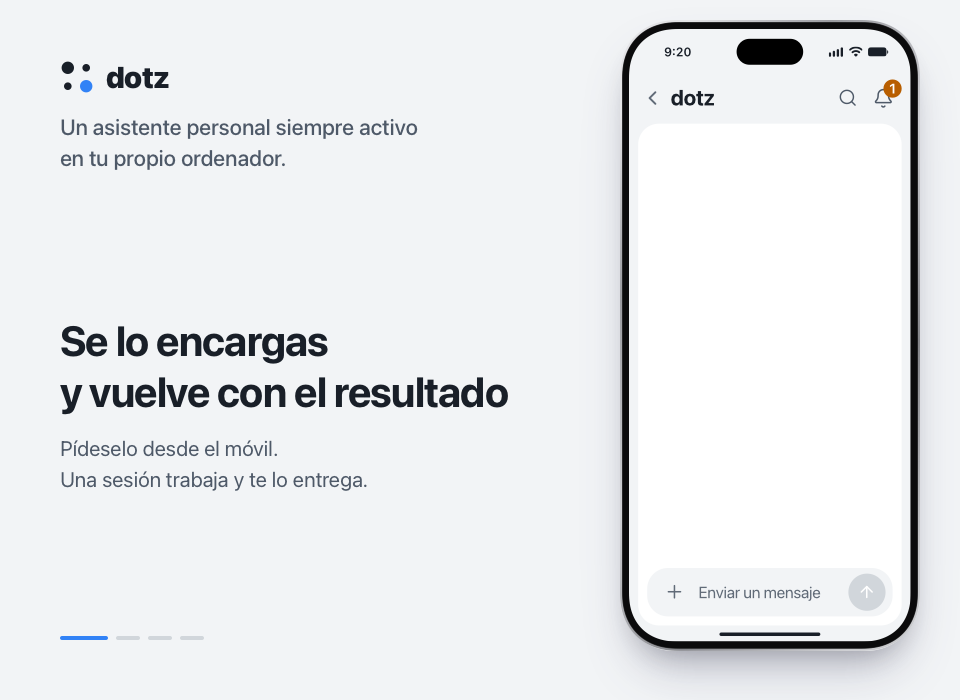

<p align="center">
  <a href="https://ddotz.dev/es/"></a>
</p>

<h1 align="center">dotz</h1>

<p align="center">
  Un asistente personal que se queda encendido en tu propio ordenador.<br>
  Lee el correo nuevo, deja escrito un borrador de respuesta y espera a que pulses enviar desde el móvil.
</p>

<p align="center">
  <a href="README.md">English</a> · <a href="README.ko.md">한국어</a> · <a href="README.ja.md">日本語</a> · <a href="README.zh-CN.md">简体中文</a> · <b>Español</b>
</p>

<p align="center">
  <a href="https://ddotz.dev/es/">Web</a> · <a href="https://ddotz.dev/demo/">Demo</a> · <a href="docs/reference.md">Documentación (en inglés)</a>
</p>

<p align="center">
  
  
  
</p>

<p align="center">
  <a href="https://ddotz.dev/demo/">
    
  </a>
</p>

## Qué lo hace distinto

- **Funciona en tu ordenador.** Usa las sesiones iniciadas y los archivos que ya tienes. Los secretos se guardan en `~/.dotz/secrets`.
- **Nada sale sin tu permiso.** Cada correo, respuesta o publicación espera en el chat hasta que lo apruebas.
- **Le escribes desde el móvil.** Por la app web, Discord, Telegram o JANDI. En Slack recibes avisos y respuestas.
- **Cada proyecto tiene su propia sesión.** Si un reinicio o un corte de red detiene una tarea, la retoma solo.
- **Encuentra conversaciones antiguas.** Puedes preguntar por "aquello de la semana pasada". El índice y la búsqueda se hacen solo en este ordenador.

## Qué sale de tu ordenador (privacidad)

dotz no tiene servidor propio ni cuenta. Esto es lo que envía y a quién.

- **Se queda aquí.** Las conversaciones, la memoria, los archivos, los secretos (`~/.dotz/secrets`), los registros y el índice de búsqueda están en este ordenador. dotz no tiene un sitio propio donde subirlos.
- **Proveedor de modelos.** Lo que un agente trabaja (tus mensajes, los archivos y la salida de comandos que lee) va al proveedor con el que iniciaste sesión en OmO o Claude Code. dotz también lee el uso de tu plan en Anthropic con tu sesión de OmO, y en OpenAI si el CLI de Codex tiene la sesión iniciada. Si añades una clave de API como respaldo (Anthropic, OpenAI, OpenRouter o un host que indicaste), los turnos que pasan al respaldo van al proveedor de esa clave con esa clave, y la clave se envía una vez a ese proveedor al pegarla, para comprobarla. Si guardaste una clave de administrador de Anthropic, dotz lee con ella el informe de costes de Anthropic.
- **Actualizaciones.** Cada 10 minutos dotz pregunta a GitHub si este repositorio tiene una versión nueva y la instala; si definiste un token de GitHub, lo envía. Cada noche también consulta npm por un OmO más reciente. En Ajustes → Actualización hay interruptores para comprobar y para instalar; con `omp_update.mode` en `off` se detiene la comprobación de OmO.
- **Preparar la búsqueda e instalar.** La primera vez, dotz descarga de npm un pequeño entorno de ejecución y de Hugging Face dos modelos para buscar en conversaciones pasadas. No se envía nada tuyo y esta descarga no tiene interruptor. El instalador descarga de GitHub y bun.sh, y las herramientas que aceptes instalar durante la configuración (como Tailscale, Homebrew o el navegador Aside) vienen de sus propios sitios; no se envía nada tuyo, salvo un token de GitHub si lo definiste para el instalador.
- **Apps que conectas.** No envían nada hasta que las conectas. Discord, Telegram, Slack y JANDI reciben los mensajes y archivos que dotz publica allí con los tokens de bot que le diste. El correo y el calendario circulan entre tus propias cuentas y este ordenador. El push web envía el título y el inicio del texto de una notificación, cifrados, al servicio push del fabricante de tu navegador, solo a los dispositivos donde permitiste notificaciones. Tailscale o Cloudflare transporta la app web si la abres desde fuera. Otros servicios que configures, como YouTube, Instagram o un webmail, y las páginas que le pidas vigilar, se consultan con tus propias sesiones. La app web escucha solo en 127.0.0.1.
- **Estadísticas de uso.** dotz no envía ninguna propia. Desactiva la telemetría de uso de OmO y el aviso de instalación de senpi, pero no configura nada en Claude Code ni en omp, así que se rigen por sus propios ajustes.
- **App web.** Sus páginas no cargan fuentes, scripts ni hojas de estilo de otros sitios.

## Instalación

```sh
curl -fsSL https://raw.githubusercontent.com/ddotz/dotz/main/install.sh | sh
```

En macOS y Linux, ejecútalo en una terminal. En Windows, dentro de WSL 2 ([guía, en coreano](docs/windows.md)).

Se abre el navegador para la configuración: eliges el nombre del asistente, su tono y qué conectar. dotz ejecuta sus agentes sobre [OmO](https://www.npmjs.com/package/omo-ai), así que inicias sesión con tu proveedor de modelos ahí. Después, escribe `dotz` en una terminal para abrir la app web. Las actualizaciones llegan solas desde este repositorio.

La configuración está en inglés y coreano, y el asistente responde en el idioma que elijas. Por ahora, las pantallas de la app web están en coreano.

## Documentación

- [Referencia](docs/reference.md): opciones de instalación, comandos, pantallas, integraciones, API
- [Arquitectura](docs/ARCHITECTURE.md)
- [Personalización](docs/customization.md)
- [Desarrollo](docs/development.md)
- [Avisos de terceros](THIRD_PARTY_NOTICES.md)
- [Licencia (MIT)](LICENSE)
