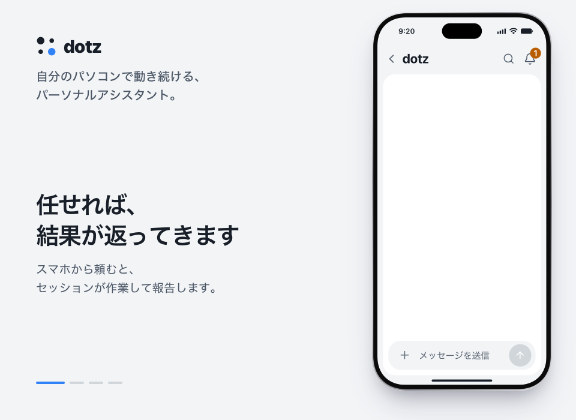

<p align="center">
  <a href="https://ddotz.dev/ja/"></a>
</p>

<h1 align="center">dotz</h1>

<p align="center">
  自分のパソコンで動き続けるパーソナルアシスタント。<br>
  新着メールを読んで返信の下書きを用意し、スマホで送信を押すまで待ちます。
</p>

<p align="center">
  <a href="README.md">English</a> · <a href="README.ko.md">한국어</a> · <b>日本語</b> · <a href="README.zh-CN.md">简体中文</a> · <a href="README.es.md">Español</a>
</p>

<p align="center">
  <a href="https://ddotz.dev/ja/">サイト</a> · <a href="https://ddotz.dev/demo/">デモ</a> · <a href="docs/reference.md">ドキュメント（英語）</a>
</p>

<p align="center">
  
  
  
</p>

<p align="center">
  <a href="https://ddotz.dev/demo/">
    
  </a>
</p>

## 特徴

- **自分のパソコンで動きます。** パソコンにあるログイン情報やファイルをそのまま使い、秘密情報は `~/.dotz/secrets` に保存します。
- **承認しないと外に出ません。** メール、返信、投稿はチャットで承認するまで送られません。
- **スマホから話しかけられます。** Web アプリ、Discord、Telegram、JANDI で会話でき、Slack では通知と返事を受け取れます。
- **プロジェクトごとにセッションが分かれます。** 再起動や回線の切断で止まった作業は自動で再開します。
- **過去の会話を探せます。** 「先週のあれ」のような聞き方で大丈夫です。インデックス作成と検索はこのパソコンの中だけで行います。

## 外に出るもの（プライバシー）

dotz には専用のサーバーもアカウントもありません。外に送られるものと送り先は次のとおりです。

- **このパソコンにあるもの。** 会話、記憶、ファイル、秘密情報（`~/.dotz/secrets`）、ログ、検索インデックスはこのパソコンに保存されます。dotz にはそれらをアップロードする自前の保存先がありません。
- **モデルのプロバイダー。** エージェントが作業する内容（あなたのメッセージ、読んだファイル、コマンドの出力）は、OmO や Claude Code でログインしたプロバイダーに送られます。プランの使用量は、OmO のログインで Anthropic から、Codex CLI にログインしていれば OpenAI から読み取ります。API キーをフォールバックとして追加した場合（Anthropic、OpenAI、OpenRouter、または自分で挙げたホスト）、フォールバックしたターンはそのキーでそのキーのプロバイダーに送られ、キーは貼り付けたときに確認のため一度だけそのプロバイダーに送られます。Anthropic の管理者キーを保存している場合は、そのキーで Anthropic からコストレポートを読み取ります。
- **アップデート。** 10 分ごとに GitHub へこのリポジトリの新しいバージョンがあるか尋ね、あれば取得して適用します。GitHub トークンを設定している場合は一緒に送ります。毎晩 npm で新しい OmO も確認します。設定 → アップデートで確認と適用をそれぞれ切れます。`omp_update.mode` を `off` にすると OmO の確認が止まります。
- **検索の準備とインストール。** 過去の会話を検索するため、初回に npm から小さな実行環境を、Hugging Face からモデル 2 つをダウンロードします。あなたのデータは送られず、このダウンロードを切るスイッチはありません。インストーラーは GitHub と bun.sh から、セットアップ中にインストールに同意したツール（Tailscale、Homebrew、Aside ブラウザなど）はそれぞれのサイトからダウンロードします。あなたのものは送られません。インストーラー用に GitHub トークンを設定している場合だけ、それが一緒に送られます。
- **つないだアプリ。** つなぐまでは何も送りません。Discord、Telegram、Slack、JANDI には、渡したボットトークンで dotz が投稿するメッセージとファイルが送られます。メールとカレンダーは、あなたのアカウントとこのパソコンの間でやり取りされます。Web プッシュは通知のタイトルと冒頭の文章を暗号化して、ブラウザ提供元のプッシュサービスへ送り、通知を許可した端末にだけ届きます。外から Web アプリを開くときは Tailscale か Cloudflare を通ります。そのほか、設定した YouTube、Instagram、ウェブメールなどのサービスや、見張るよう頼んだページには、あなた自身のログインでアクセスします。Web アプリ自体は 127.0.0.1 でのみ待ち受けます。
- **利用統計。** dotz 自身が送るものはありません。OmO の利用統計と senpi のインストール通知はオフにしますが、Claude Code と omp には何も設定しないので、それぞれの設定に従います。
- **Web アプリ。** 画面は他のサイトのフォント、スクリプト、スタイルシートを読み込みません。

## インストール

```sh
curl -fsSL https://raw.githubusercontent.com/ddotz/dotz/main/install.sh | sh
```

macOS と Linux ではターミナルで、Windows では WSL 2 の中で実行します（[Windows の手順、韓国語](docs/windows.md)）。

ブラウザが開くので、アシスタントの名前、話し方、つなぐサービスを順に選びます。エージェントは [OmO](https://www.npmjs.com/package/omo-ai) の上で動くため、モデルのアカウントには OmO でログインします。セットアップ後はターミナルで `dotz` と打つと Web アプリが開きます。アップデートはこのリポジトリから自動で届きます。

セットアップ画面は英語と韓国語で、アシスタントは設定した言語で返事をします。Web アプリの画面は今のところ韓国語です。

## ドキュメント

- [リファレンス](docs/reference.md)：インストールオプション、コマンド、画面、連携、API
- [アーキテクチャ](docs/ARCHITECTURE.md)
- [カスタマイズ](docs/customization.md)
- [開発ガイド](docs/development.md)
- [サードパーティーの表示](THIRD_PARTY_NOTICES.md)
- [ライセンス（MIT）](LICENSE)
