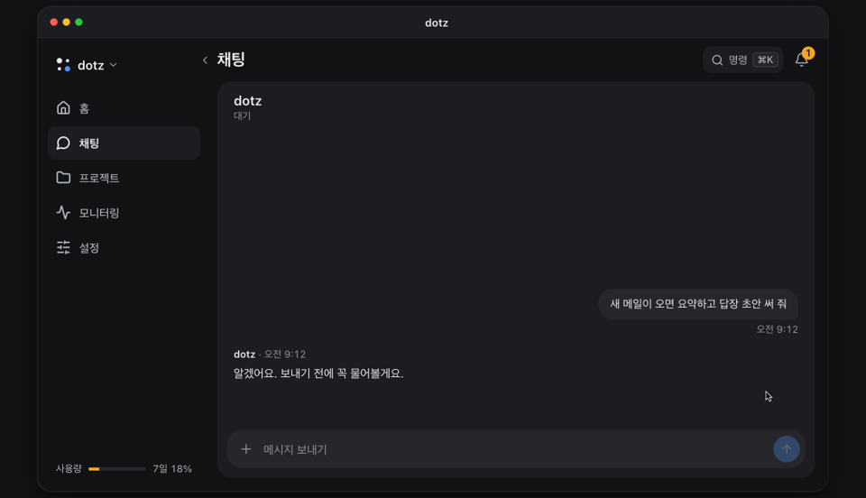

<p align="center">
  <a href="https://ddotz.dev/ko/"></a>
</p>

<h1 align="center">dotz</h1>

<p align="center">
  내 컴퓨터에서 항상 켜져 있는 개인 비서.<br>
  새 메일을 읽고 답장 초안을 써 둔 뒤, 폰에서 내가 보내기를 누를 때까지 기다려요.
</p>

<p align="center">
  <a href="README.md">English</a> · <b>한국어</b> · <a href="README.ja.md">日本語</a> · <a href="README.zh-CN.md">简体中文</a> · <a href="README.es.md">Español</a>
</p>

<p align="center">
  <a href="https://ddotz.dev/ko/">웹사이트</a> · <a href="https://ddotz.dev/demo/">데모</a> · <a href="docs/reference.md">문서</a>
</p>

<p align="center">
  
  
  
</p>

<p align="center">
  <a href="https://ddotz.dev/demo/">
    
  </a>
</p>

## 다른 점

- **내 컴퓨터에서 돌아요.** 이 컴퓨터에 있는 로그인과 파일을 그대로 쓰고, 비밀값은 `~/.dotz/secrets`에 둬요.
- **내가 허락해야 밖으로 나가요.** 메일, 답장, 게시글은 채팅에서 승인할 때까지 기다려요.
- **폰에서 말을 걸어요.** 웹 앱, Discord, Telegram, JANDI로 대화하고, Slack으로는 알림과 답을 받아요.
- **프로젝트마다 세션이 따로예요.** 재시작이나 네트워크 끊김으로 멈춘 일은 알아서 다시 이어가요.
- **지난 대화를 찾아 줘요.** "지난주에 그거"처럼 막연하게 물어도 돼요. 색인과 검색은 이 컴퓨터 안에서만 돌아요.

## 밖으로 나가는 것 (개인정보)

dotz에는 자체 서버도 가입도 없어요. 밖으로 나가는 것과 보내는 곳은 아래와 같아요.

- **이 컴퓨터에 있는 것.** 대화, 기억, 파일, 비밀값(`~/.dotz/secrets`), 로그, 검색 색인은 이 컴퓨터에 저장돼요. dotz가 이것들을 올려 둘 자체 저장소는 없어요.
- **모델 제공사.** 에이전트가 일하는 내용(내 메시지, 읽은 파일, 명령 출력)은 OmO나 Claude Code로 로그인한 모델 제공사에 가요. 요금제 사용량은 OmO 로그인으로 Anthropic에서, Codex CLI에 로그인돼 있으면 OpenAI에서 읽어 와요. API 키를 대체 수단으로 추가하면(Anthropic, OpenAI, OpenRouter, 또는 내가 적어 둔 호스트) 대체되는 턴은 그 키로 그 키의 제공사에 가고, 키는 붙여 넣을 때 확인용으로 그 제공사에 한 번 보내요. Anthropic 관리자 키를 저장해 뒀다면 그 키로 Anthropic에서 비용 리포트를 읽어요.
- **업데이트.** 10분마다 GitHub에 이 저장소의 새 버전이 있는지 묻고 받아서 적용해요. GitHub 토큰을 설정했다면 함께 보내요. 밤마다 npm에서 새 OmO가 있는지도 확인해요. 설정 → 업데이트에서 확인과 적용을 각각 끌 수 있고, `omp_update.mode`를 `off`로 두면 OmO 확인이 멈춰요.
- **검색 준비와 설치.** 지난 대화 검색을 위해 처음에 npm에서 작은 실행 환경을, Hugging Face에서 모델 두 개를 내려받아요. 내 데이터는 나가지 않고, 이 내려받기에는 끄는 스위치가 없어요. 설치 스크립트는 GitHub와 bun.sh에서, 설정 중 설치에 동의한 도구(Tailscale, Homebrew, Aside 브라우저 등)는 각자의 사이트에서 내려받아요. 내 것은 나가지 않아요. 설치 스크립트용 GitHub 토큰을 설정해 뒀다면 그것만 함께 가요.
- **연결한 앱.** 연결하기 전에는 아무것도 보내지 않아요. Discord, Telegram, Slack, JANDI에는 내가 준 봇 토큰으로 dotz가 올리는 메시지와 파일이 가요. 메일과 캘린더는 내 계정과 이 컴퓨터 사이에서 오가요. 웹 푸시는 알림의 제목과 첫 글을 암호화해 브라우저 제작사의 푸시 서비스로 보내고, 알림을 허용한 기기에만 가요. 밖에서 웹 앱을 열면 Tailscale이나 Cloudflare를 거쳐요. 그 밖에 설정한 YouTube, Instagram, 웹메일 같은 서비스와 지켜보라고 한 페이지는 내 로그인으로 불러요. 웹 앱 자체는 127.0.0.1에서만 열려 있어요.
- **사용 통계.** dotz가 직접 보내는 것은 없어요. OmO의 사용 통계와 senpi 설치 알림은 꺼 두지만, Claude Code와 omp에는 아무것도 설정하지 않아서 그 도구 자체 설정을 따라요.
- **웹 앱.** 화면은 다른 사이트의 글꼴, 스크립트, 스타일시트를 불러오지 않아요.

## 설치

```sh
curl -fsSL https://raw.githubusercontent.com/ddotz/dotz/main/install.sh | sh
```

맥과 리눅스는 터미널에서, 윈도우는 WSL 2 안에서 실행해요([윈도우 설치 가이드](docs/windows.md)).

브라우저가 열리면 이름과 말투, 연결할 것을 차례로 정해요. 에이전트는 [OmO](https://www.npmjs.com/package/omo-ai) 위에서 돌아서, 모델 계정 로그인은 OmO에서 해요. 설치가 끝나면 터미널에 `dotz`만 쳐도 웹 앱이 열리고, 업데이트는 이 저장소에서 알아서 받아요.

## 문서

- [전체 레퍼런스](docs/reference.md): 설치 옵션, 명령어, 화면, 연동, API
- [밖에서 웹 앱 열기](docs/web-access.ko.md)
- [메신저 연결](docs/messengers/README.ko.md)
- [맥락 검색](docs/context-search.md)
- [내 설정으로 바꾸기](docs/customization.md)
- [구조](docs/ARCHITECTURE.md) · [개발 가이드](docs/development.md) · [서드파티 고지](THIRD_PARTY_NOTICES.md)
- [라이선스(MIT)](LICENSE)
