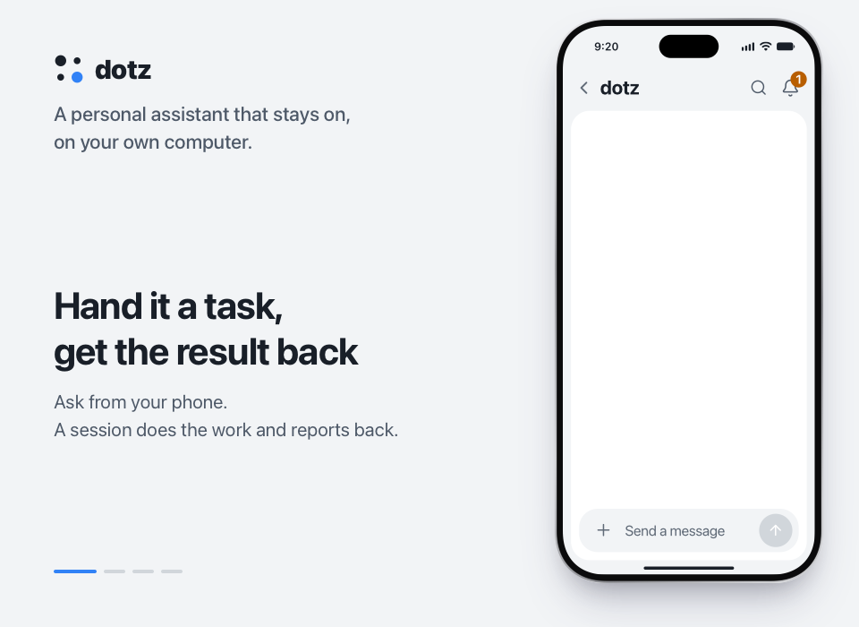

<p align="center">
  <a href="https://ddotz.dev"></a>
</p>

<h1 align="center">dotz</h1>

<p align="center">
  A personal assistant that stays on, on your own computer.<br>
  It reads new mail, drafts the reply, and waits for you to press send from your phone.
</p>

<p align="center">
  <b>English</b> · <a href="README.ko.md">한국어</a> · <a href="README.ja.md">日本語</a> · <a href="README.zh-CN.md">简体中文</a> · <a href="README.es.md">Español</a>
</p>

<p align="center">
  <a href="https://ddotz.dev">Website</a> · <a href="https://ddotz.dev/demo/">Live demo</a> · <a href="docs/reference.md">Docs</a>
</p>

<p align="center">
  
  
  
</p>

<p align="center">
  <a href="https://ddotz.dev/demo/">
    
  </a>
</p>

## Why dotz

- **It runs on your machine.** It uses the logins and files already on your computer. Secrets stay in `~/.dotz/secrets`.
- **Nothing goes out without your OK.** Every mail, reply or post waits in the chat until you approve it.
- **You reach it from your phone.** Use the web app, Discord, Telegram or JANDI. Slack receives notices and answers.
- **Each project gets its own session.** Work stopped by a restart or a dropped connection starts again by itself.
- **It finds past conversations.** Ask for "that thing from last week". Indexing and search run on this computer only.

## What leaves your computer (privacy)

dotz has no server of its own and no account. Here is what it sends out, and to whom.

- **Stored here.** Conversations, memory, files, secrets (`~/.dotz/secrets`), logs and the search index live on this computer. dotz has no place of its own to upload them to.
- **Model provider.** What an agent works on (your messages, the files and command output it reads) goes to the provider you signed in to through OmO or Claude Code. dotz also reads your plan usage from Anthropic with your OmO login, and from OpenAI if the Codex CLI is signed in. If you add an API key as a fallback (Anthropic, OpenAI, OpenRouter, or a host you listed), the turns that fall back go to that key's provider with that key, and the key is sent once to that provider when you paste it, to check it. If you stored an Anthropic admin key, dotz reads your cost report from Anthropic with it.
- **Updates.** Every 10 minutes dotz asks GitHub whether this repo has a new version and installs it, sending your GitHub token if you set one. It also checks npm for a newer OmO each night. Settings → Update has switches for checking and for installing; `omp_update.mode` set to `off` stops the OmO check.
- **Search setup and installs.** The first time, dotz downloads a small runtime from npm and two models from Hugging Face for past-conversation search. Nothing of yours is sent, and this download has no switch. The installer fetches from GitHub and bun.sh, and the tools you agree to install during setup (such as Tailscale, Homebrew or the Aside browser) come from their own sites; nothing of yours is sent, except a GitHub token if you set one for the installer.
- **Apps you connect.** These send nothing until you connect them. Discord, Telegram, Slack and JANDI get the messages and files dotz posts there, using the bot tokens you gave it. Mail and calendar traffic runs between your own accounts and this computer. Web push sends a notification's title and first text, encrypted, to your browser vendor's push service, only for devices where you allowed notifications. Tailscale or Cloudflare carries the web app if you open it from outside. Other services you set up, such as YouTube, Instagram or a webmail site, and pages you ask it to watch, are called with your own logins. The web app itself listens on 127.0.0.1 only.
- **Usage statistics.** dotz sends none of its own. It switches off OmO's usage telemetry and the senpi install ping, but sets nothing for Claude Code or omp, so their own settings apply.
- **Web app.** Its pages load no font, script or stylesheet from another site.

## Install

```sh
curl -fsSL https://raw.githubusercontent.com/ddotz/dotz/main/install.sh | sh
```

Run it in a terminal on macOS or Linux. On Windows, run it inside WSL 2 ([guide, in Korean](docs/windows.md)).

A browser opens for setup, where you pick the assistant's name, its tone and what to connect. dotz runs its agents on [OmO](https://www.npmjs.com/package/omo-ai), so you sign in to a model provider there. After setup, type `dotz` in a terminal to open the web app. Updates come from this repo on their own.

The setup screens are in English and Korean, and the assistant replies in the language you set. The web app follows that language too: Korean and English ship with it, and for any other language it writes its own screen text once, with the model you connected.

## Docs

- [Reference](docs/reference.md): install options, commands, screens, integrations, API
- [Architecture](docs/ARCHITECTURE.md)
- [Customization](docs/customization.md)
- [Development](docs/development.md)
- [Third-party notices](THIRD_PARTY_NOTICES.md)
- [License (MIT)](LICENSE)
