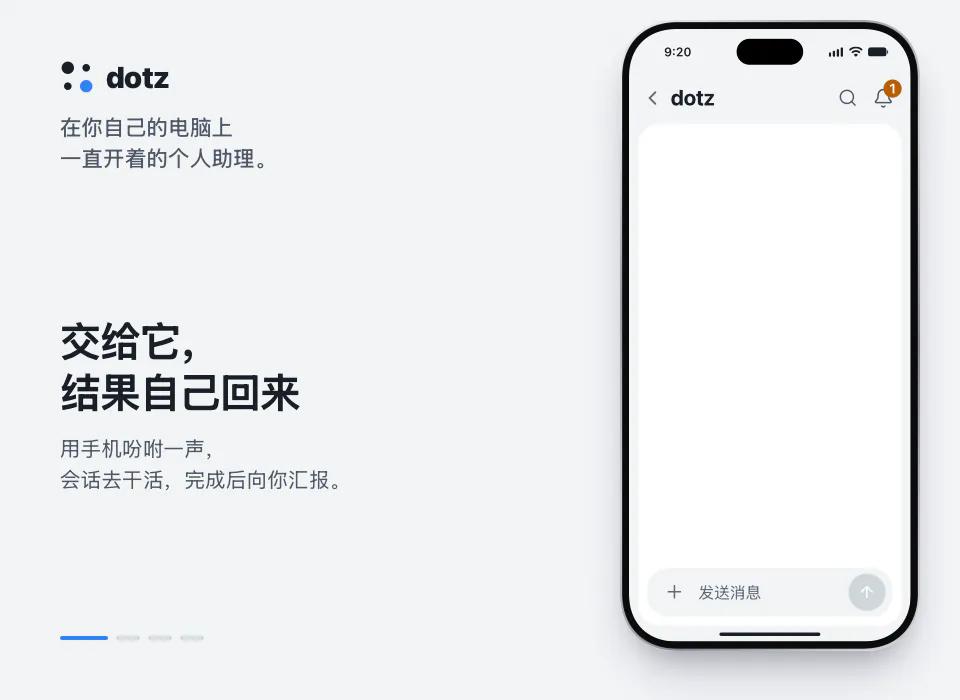

<p align="center">
  <a href="https://ddotz.dev/zh-cn/"></a>
</p>

<h1 align="center">dotz</h1>

<p align="center">
  在你自己的电脑上一直运行的个人助理。<br>
  它读新邮件、写好回复草稿，然后等你在手机上点发送。
</p>

<p align="center">
  <a href="README.md">English</a> · <a href="README.ko.md">한국어</a> · <a href="README.ja.md">日本語</a> · <b>简体中文</b> · <a href="README.es.md">Español</a>
</p>

<p align="center">
  <a href="https://ddotz.dev/zh-cn/">网站</a> · <a href="https://ddotz.dev/demo/">演示</a> · <a href="docs/reference.md">文档（英文）</a>
</p>

<p align="center">
  
  
  
</p>

<p align="center">
  <a href="https://ddotz.dev/demo/">
    
  </a>
</p>

## 有什么不同

- **在你的电脑上运行。** 直接使用这台电脑上已有的登录状态和文件，密钥保存在 `~/.dotz/secrets`。
- **不经你同意，什么都不会发出去。** 邮件、回复和帖子都会留在聊天里，等你批准。
- **用手机就能找它。** 可以通过网页应用、Discord、Telegram 或 JANDI 对话，Slack 用来接收通知和回复。
- **每个项目有自己的会话。** 因重启或断网中断的工作会自动接着做完。
- **能找回以前的对话。** 像“上周那个”这样随口一问也行。建索引和搜索都只在这台电脑上进行。

## 哪些内容会离开你的电脑（隐私）

dotz 没有自己的服务器，也不需要账号。下面是它会发出去的内容，以及发给谁。

- **留在这台电脑上的。** 对话、记忆、文件、密钥（`~/.dotz/secrets`）、日志和搜索索引都保存在这台电脑上。dotz 没有自己的地方可以上传它们。
- **模型提供商。** 代理处理的内容（你的消息、它读取的文件和命令输出）会发给你通过 OmO 或 Claude Code 登录的模型提供商。dotz 还会用你的 OmO 登录向 Anthropic 读取套餐用量，如果 Codex CLI 已登录，也会向 OpenAI 读取。如果你添加 API 密钥作为备用（Anthropic、OpenAI、OpenRouter，或你列出的主机），转到备用的那几轮会用这把密钥发给对应的提供商；密钥在你粘贴时会为了验证向该提供商发送一次。如果你保存了 Anthropic 管理员密钥，dotz 会用它向 Anthropic 读取费用报告。
- **更新。** 每 10 分钟，dotz 会问 GitHub 这个仓库有没有新版本，有就下载并安装；如果你设置了 GitHub 令牌，也会一并发送。每晚还会到 npm 检查有没有更新的 OmO。设置 → 更新里可以分别关闭检查和安装；把 `omp_update.mode` 设为 `off` 可停止检查 OmO。
- **搜索准备与安装。** 为了搜索过去的对话，首次会从 npm 下载一个小型运行环境，从 Hugging Face 下载两个模型。不会发送你的数据，这个下载没有开关。安装脚本会从 GitHub 和 bun.sh 下载，设置过程中你同意安装的工具（如 Tailscale、Homebrew、Aside 浏览器）会从各自的网站下载；不会发送你的任何东西，只有在你为安装脚本设置了 GitHub 令牌时，才会一并发送。
- **你连接的应用。** 连接之前不会发送任何东西。Discord、Telegram、Slack 和 JANDI 会收到 dotz 用你提供的机器人令牌发出的消息和文件。邮件和日历的数据在你自己的账号与这台电脑之间往来。网页推送会把通知的标题和开头文字加密后发到浏览器厂商的推送服务，只发给你允许通知的设备。从外面打开网页应用时，会经过 Tailscale 或 Cloudflare。你设置的其他服务（如 YouTube、Instagram、网页邮箱）以及你让它盯着的页面，会用你自己的登录去访问。网页应用本身只监听 127.0.0.1。
- **使用统计。** dotz 自己不发送任何统计。它会关闭 OmO 的使用遥测和 senpi 的安装通知，但不会为 Claude Code 或 omp 设置任何东西，它们按各自的设置运行。
- **网页应用。** 页面不会从其他网站加载字体、脚本或样式表。

## 安装

```sh
curl -fsSL https://raw.githubusercontent.com/ddotz/dotz/main/install.sh | sh
```

在 macOS 和 Linux 上直接在终端运行，Windows 上在 WSL 2 里运行（[Windows 安装说明，韩文](docs/windows.md)）。

浏览器会打开设置页面，依次选择助理的名字、说话方式和要连接的服务。dotz 的代理运行在 [OmO](https://www.npmjs.com/package/omo-ai) 上，模型账号在 OmO 里登录。设置完成后，在终端输入 `dotz` 就能打开网页应用。更新会自动从这个仓库获取。

设置页面有英文和韩文，助理会用你设定的语言回复。网页应用的界面目前是韩文。

## 文档

- [参考手册](docs/reference.md)：安装选项、命令、界面、集成、API
- [架构](docs/ARCHITECTURE.md)
- [自定义](docs/customization.md)
- [开发指南](docs/development.md)
- [第三方声明](THIRD_PARTY_NOTICES.md)
- [许可证（MIT）](LICENSE)
