<!-- generated by hub/screen-map.ts; do not edit -->
# Screen map

Which screens each web area opens, and which overlays it shows. Generated from `web/js/*.js`, `web/custom.js`, `web/index.html`, `hub/ui-surfaces.json` and `hub/web-areas.json` by `bun hub/screen-map.ts`; `bun hub/screen-map.ts --check` fails when this file is stale.

- a box is an area of `web/` (`custom` is `web/custom.js`); the rounded node inside is the area's own code
- a screen sits in the area that declares its view; an arrow labelled `go (n)` is n `go()` calls from that area's code to the screen
- `kind (n)` nodes are the overlays the area opens (dialog, ask, menu, toast, ...) with their number of call sites

```mermaid
flowchart LR
  subgraph a_boot["boot"]
    c_boot(["boot code"])
  end
  subgraph a_chat["chat"]
    c_chat(["chat code"])
    o_chat_ask["ask (5)"]
    o_chat_dialog["dialog (2)"]
    o_chat_float["float (1)"]
    o_chat_fsOpen["fsOpen (1)"]
    o_chat_menu["menu (7)"]
    o_chat_overlay["overlay (1)"]
    o_chat_rawdialog["rawdialog (1)"]
    o_chat_reveal["reveal (3)"]
    o_chat_select["select (1)"]
    o_chat_toast["toast (56)"]
  end
  subgraph a_comments["comments"]
    c_comments(["comments code"])
    o_comments_dialog["dialog (1)"]
    o_comments_select["select (1)"]
    o_comments_toast["toast (6)"]
  end
  subgraph a_core["core"]
    c_core(["core code"])
    s_accounts["accounts: 계정"]
    s_activity["activity: 채팅 작업내역"]
    s_cardform["cardform: 카드 양식"]
    s_chat["chat: 채팅"]
    s_context["context: 컨텍스트"]
    s_custom["custom: 내 규칙·커스텀"]
    s_devices["devices: 연결된 기기"]
    s_discord["discord: Discord 연결"]
    s_display["display: 표시 설정"]
    s_harness["harness: 구성(시스템 지도)"]
    s_home["home: 홈"]
    s_jandi["jandi: JANDI 연결"]
    s_messengers["messengers: 메신저"]
    s_models["models: 모델 · 폴백"]
    s_monitoring["monitoring: 모니터링"]
    s_notices["notices: 알림"]
    s_notifications["notifications: 앱과 알림 설정"]
    s_project["project: 프로젝트 상세"]
    s_projects["projects: 프로젝트 목록"]
    s_runtime["runtime: 실행 하네스"]
    s_schedules["schedules: 예약한 일"]
    s_settings["settings: 설정"]
    s_slack["slack: Slack 연결"]
    s_telegram["telegram: Telegram 연결"]
    s_update["update: 업데이트"]
    s_usage["usage: 사용량과 월 한도"]
    s_webaccess["webaccess: 웹 접속"]
    o_core_dialog["dialog (2)"]
    o_core_float["float (1)"]
    o_core_overlay["overlay (1)"]
    o_core_palette["palette (1)"]
    o_core_toast["toast (6)"]
  end
  subgraph a_custom["custom"]
    c_custom(["custom code"])
    o_custom_ask["ask (4)"]
    o_custom_toast["toast (12)"]
  end
  subgraph a_harness["harness"]
    c_harness(["harness code"])
    o_harness_ask["ask (2)"]
    o_harness_menu["menu (1)"]
    o_harness_select["select (2)"]
    o_harness_toast["toast (2)"]
  end
  subgraph a_home["home"]
    c_home(["home code"])
    o_home_ask["ask (2)"]
    o_home_menu["menu (5)"]
    o_home_toast["toast (7)"]
  end
  subgraph a_kakao["kakao"]
    c_kakao(["kakao code"])
    o_kakao_dialog["dialog (2)"]
    o_kakao_rawdialog["rawdialog (1)"]
    o_kakao_toast["toast (16)"]
  end
  subgraph a_mail["mail"]
    c_mail(["mail code"])
    o_mail_ask["ask (6)"]
    o_mail_dialog["dialog (1)"]
    o_mail_float["float (2)"]
    o_mail_fsOpen["fsOpen (1)"]
    o_mail_menu["menu (3)"]
    o_mail_toast["toast (37)"]
  end
  subgraph a_monitoring["monitoring"]
    c_monitoring(["monitoring code"])
    o_monitoring_ask["ask (1)"]
    o_monitoring_dialog["dialog (1)"]
    o_monitoring_fsOpen["fsOpen (2)"]
    o_monitoring_menu["menu (1)"]
    o_monitoring_overlay["overlay (1)"]
    o_monitoring_select["select (1)"]
    o_monitoring_toast["toast (35)"]
  end
  subgraph a_notices["notices"]
    c_notices(["notices code"])
    o_notices_fsOpen["fsOpen (2)"]
    o_notices_toast["toast (27)"]
  end
  subgraph a_panes["panes"]
    c_panes(["panes code"])
    o_panes_dialog["dialog (1)"]
    o_panes_float["float (2)"]
    o_panes_toast["toast (7)"]
  end
  subgraph a_peers["peers"]
    c_peers(["peers code"])
    o_peers_ask["ask (1)"]
    o_peers_dialog["dialog (1)"]
    o_peers_float["float (2)"]
    o_peers_menu["menu (1)"]
    o_peers_overlay["overlay (2)"]
    o_peers_toast["toast (9)"]
  end
  subgraph a_projects["projects"]
    c_projects(["projects code"])
    o_projects_dialog["dialog (1)"]
    o_projects_fsOpen["fsOpen (3)"]
    o_projects_menu["menu (1)"]
    o_projects_toast["toast (7)"]
  end
  subgraph a_reply["reply"]
    c_reply(["reply code"])
    o_reply_fsOpen["fsOpen (2)"]
    o_reply_overlay["overlay (1)"]
    o_reply_select["select (1)"]
    o_reply_toast["toast (2)"]
  end
  subgraph a_settings["settings"]
    c_settings(["settings code"])
    o_settings_ask["ask (8)"]
    o_settings_dialog["dialog (17)"]
    o_settings_float["float (2)"]
    o_settings_menu["menu (3)"]
    o_settings_select["select (8)"]
    o_settings_toast["toast (58)"]
  end
  subgraph a_shell["shell"]
    c_shell(["shell code"])
    o_shell_dialog["dialog (1)"]
    o_shell_float["float (1)"]
    o_shell_menu["menu (1)"]
    o_shell_toast["toast (10)"]
  end
  s_any["(computed screen)"]
  c_boot -->|"go (1)"| s_any
  c_boot -->|"go (1)"| s_home
  c_boot -->|"go (1)"| s_usage
  c_chat -->|"go (5)"| s_any
  c_chat -->|"go (6)"| s_chat
  c_chat -->|"go (1)"| s_context
  c_chat -->|"go (1)"| s_home
  c_chat -->|"go (4)"| s_monitoring
  c_chat -->|"go (1)"| s_usage
  c_core -->|"go (9)"| s_any
  c_core -->|"go (2)"| s_chat
  c_core -->|"go (1)"| s_home
  c_core -->|"go (1)"| s_monitoring
  c_custom -->|"go (2)"| s_cardform
  c_custom -->|"go (3)"| s_home
  c_harness -->|"go (1)"| s_harness
  c_home -->|"go (2)"| s_any
  c_home -->|"go (4)"| s_accounts
  c_home -->|"go (2)"| s_chat
  c_home -->|"go (2)"| s_context
  c_home -->|"go (3)"| s_monitoring
  c_home -->|"go (2)"| s_usage
  c_kakao -->|"go (4)"| s_any
  c_mail -->|"go (2)"| s_any
  c_mail -->|"go (6)"| s_monitoring
  c_monitoring -->|"go (2)"| s_chat
  c_monitoring -->|"go (12)"| s_monitoring
  c_notices -->|"go (1)"| s_any
  c_notices -->|"go (1)"| s_accounts
  c_notices -->|"go (1)"| s_chat
  c_notices -->|"go (1)"| s_home
  c_notices -->|"go (2)"| s_monitoring
  c_notices -->|"go (3)"| s_notices
  c_notices -->|"go (1)"| s_projects
  c_notices -->|"go (2)"| s_update
  c_panes -->|"go (2)"| s_chat
  c_peers -->|"go (2)"| s_any
  c_peers -->|"go (3)"| s_chat
  c_peers -->|"go (2)"| s_home
  c_peers -->|"go (1)"| s_settings
  c_projects -->|"go (1)"| s_monitoring
  c_projects -->|"go (3)"| s_project
  c_projects -->|"go (1)"| s_projects
  c_reply -->|"go (2)"| s_any
  c_reply -->|"go (3)"| s_monitoring
  c_settings -->|"go (2)"| s_any
  c_settings -->|"go (1)"| s_accounts
  c_settings -->|"go (1)"| s_chat
  c_settings -->|"go (1)"| s_context
  c_settings -->|"go (1)"| s_custom
  c_settings -->|"go (2)"| s_devices
  c_settings -->|"go (1)"| s_display
  c_settings -->|"go (1)"| s_harness
  c_settings -->|"go (1)"| s_messengers
  c_settings -->|"go (1)"| s_models
  c_settings -->|"go (2)"| s_notifications
  c_settings -->|"go (1)"| s_runtime
  c_settings -->|"go (1)"| s_schedules
  c_settings -->|"go (1)"| s_update
  c_settings -->|"go (1)"| s_usage
  c_settings -->|"go (1)"| s_webaccess
  c_shell -->|"go (1)"| s_home
  c_shell -->|"go (1)"| s_settings
```

